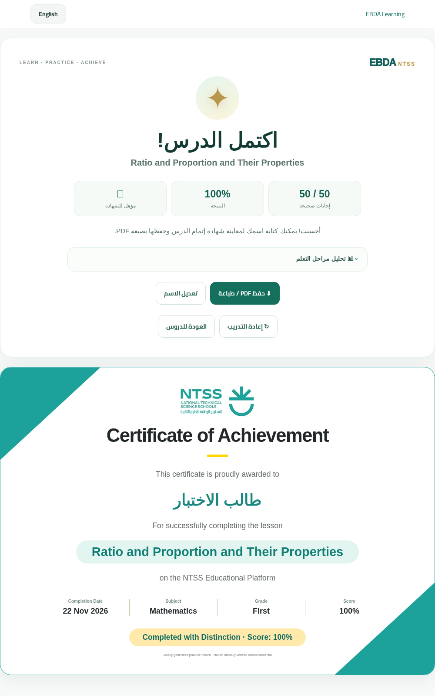
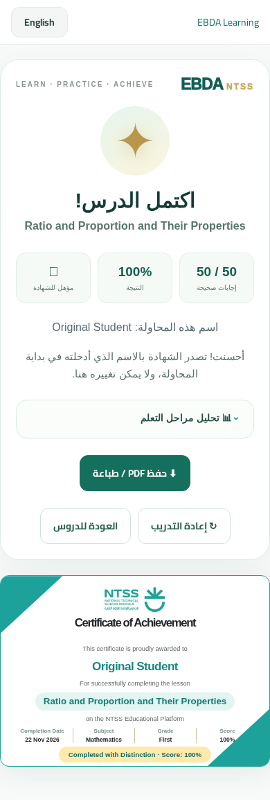
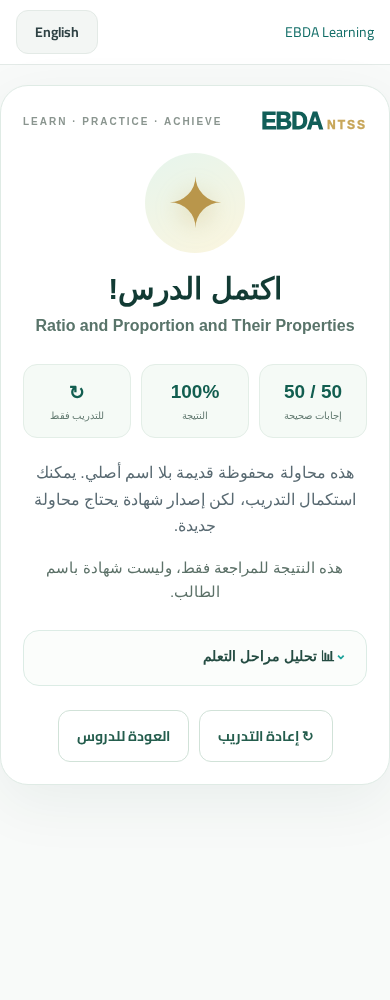

# Certificate name bound to the original practice attempt

## Changes

- The lesson-entry name is read-only for that attempt. Completion has no name input or Edit name action.
- The existing device-local checkpoint now includes the original name. Resume restores that name with its answers, even if a different name was entered after a reload.
- Name and answers remain on this device only, within the existing seven-day checkpoint lifetime. Completion and explicit draft clearing remove the saved draft immediately. Expired drafts cannot resume and are removed on the next site visit or checkpoint access; a closed browser cannot run cleanup. Names are not sent to a server.
- Existing checkpoints without an original name remain usable for learning. They cannot issue a named certificate. A fresh full attempt is required. This migration behavior and the device-local name retention were explicitly approved by the project owner.
- Entry copy, practice identity notices and the Arabic/English privacy footer explain the behavior.
- The assessed 70% threshold, ungraded project participation, original curriculum text, AI learning stages and labs are unchanged.

This is local name consistency, not identity verification. The site has no student account backend. A student can still start under someone else's name, and someone controlling their browser can alter local data or generated output. This change must not be described as tamper-proof certification.

## Review images

All names in these images are synthetic test data. Before is from production before this change. After images are from the checked-out review version, not a deployed preview.

### Before: final Edit name action

### After: original name, print only

### Reload and alternate name entry still restore the original

### Legacy draft: learning continues without a named certificate

## Regression evidence

- 112 full representative subject/year, Arabic/English, phone/desktop completion cases. No final name-edit controls or JavaScript exceptions.
- Six actual page-reload cases: AI, Mathematics and Data Analysis, each with a bound checkpoint and an old nameless checkpoint. Answers persist, original names restore, and old checkpoints remain learning-only.
- Existing project participation verified with its original name and functioning Print action.
- Seven-day expiry and denied local storage checked. Synthetic names are escaped before rendering.
- Existing assessment coverage, 603 lesson-path audit, Data Analysis progression, four-size Chromium assessment and real Python/SQLite workers, security checks and 24 bilingual lab integration cases pass.
- New name browser tests run from the existing Chromium assessment workflow. No tests or workflows were removed or weakened. The older synthetic resume tests now enter the test student's name before saving, matching the real UI's name-first flow.

No physical iPhone/Safari testing is claimed. The previously known WebKit offline-engine failure and separate old publish-workflow runner incompatibility are not changed here.
